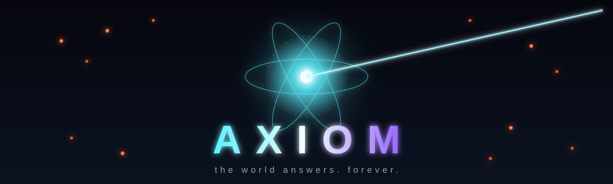
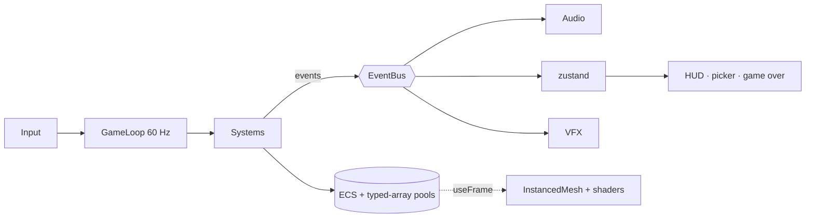

<div align="center">



<br/>

**An infinite 3D *god mode* bullet hell for the browser.**
You are the Unbound. The world will not stop sending things to stop you.

<br/>


[Design](docs/GDD.md) · [Architecture](docs/ARCHITECTURE.md) · [Factions](docs/FACTIONS.md) · [Upgrades](docs/UPGRADES.md) · [Roadmap](docs/ROADMAP.md)

</div>

---

## The premise

> *Run 4,812. Containment nominal. Another quiet night.*

A quantum containment field fails, and the researcher standing in front of it comes apart atom by atom. Something remembers their shape and puts it back together as **the Unbound**: a body of light with lattice lines running through it, which physics no longer applies to.

You wake up in the ruined facility, and the world responds. Each response is bigger than the last:

```
police → SWAT → army → armor → air → secret societies → aliens
      → the Meridian Compact → the Demiurge → cosmic entities
                    → a new Cycle, harder ↺
```

The game never ends, and there is no victory screen. The question is how far into the Cycles you can get.

## Your powers

| | Power | What it does |
|:-:|---|---|
| ◎ | **Aura** | A passive pulsing field that shreds enemies and crushes buildings and vehicles around you. |
| ━ | **Erasure Beam** | Hold the mouse to channel it. Targets are not killed but *erased*: they freeze, flatten into a glitch and vanish without a trace. |
| ✦ | **Ascension** | Every level-up pauses time and offers 3 buffs: multi-ray beams, atom satellites, time dilation, gravity wells, echo clones, blink and more, with rarities and synergies. |

The threat is volume. Each bullet barely hurts, but there are thousands of them.

## Controls

| Input | Action |
|---|---|
| <kbd>W</kbd><kbd>A</kbd><kbd>S</kbd><kbd>D</kbd> | Move (hover) |
| <kbd>Mouse</kbd> | Aim |
| <kbd>LMB</kbd> hold | Erasure Beam |
| <kbd>Space</kbd> | Blink (buff) / skip cutscene |
| <kbd>1</kbd><kbd>2</kbd><kbd>3</kbd> | Pick a buff |
| <kbd>Esc</kbd> | Pause |
| <kbd>F3</kbd> | Debug overlay |

## Tech

<table>
<tr><td><b>Framework</b></td><td>Next.js (App Router) · TypeScript strict · Tailwind for HUD/UI</td></tr>
<tr><td><b>Rendering</b></td><td>three.js via <code>@react-three/fiber</code>, <code>drei</code>, <code>postprocessing</code>; <code>InstancedMesh</code> pools and custom shaders</td></tr>
<tr><td><b>Simulation</b></td><td>Fixed 60 Hz timestep running outside React · minimal sparse-set ECS · typed-array pools for bullets · spatial-hash collision on the ground plane</td></tr>
<tr><td><b>State</b></td><td>zustand, only for low-frequency state (phase, picker, settings); no per-frame React re-renders</td></tr>
<tr><td><b>Audio</b></td><td>Custom Web Audio manager · 5-stem adaptive orchestral and guitar score · procedural fallbacks, so the game is never silent</td></tr>
</table>



## Getting started

> [!NOTE]
> The repository is in **Phase 0** (design and knowledge base). The game code arrives in Phase 1.

```bash
npm install
npm run dev        # http://localhost:3000
npm run build      # zero TS/ESLint errors required
npm run test
```

## Project map

```
src/
  app/        routes: / (menu), /play
  game/       core · ecs · systems · entities · factions · waves
              upgrades · rendering · audio · cutscene · config
  ui/         HUD, upgrade picker, pause, game over
  store/      zustand stores
docs/         design and engineering knowledge base
.claude/      Claude Code project skills
```

## Documentation

| Doc | |
|---|---|
| [GDD](docs/GDD.md) | Concept, story, loop, mechanics, Cycle scaling |
| [ARCHITECTURE](docs/ARCHITECTURE.md) | Loop, ECS, events, state ownership, rendering |
| [FACTIONS](docs/FACTIONS.md) | Tiers, units, bullet patterns, bosses |
| [UPGRADES](docs/UPGRADES.md) | Buff catalog, rarity, stacking, synergies |
| [ART_DIRECTION](docs/ART_DIRECTION.md) | Palette, shaders, VFX, IP originality checklist |
| [AUDIO](docs/AUDIO.md) | Adaptive stems, SFX, mixing |
| [CUTSCENE](docs/CUTSCENE.md) | Intro script and JSON schema |
| [PERFORMANCE](docs/PERFORMANCE.md) | Budgets, pooling, profiling |
| [ROADMAP](docs/ROADMAP.md) · [DECISIONS](docs/DECISIONS.md) · [DEVLOG](docs/DEVLOG.md) | Plan, ADRs, session log |

## Roadmap

- [x] **Phase 0**: design docs, architecture, project skills
- [ ] **Phase 1**: scaffold, fixed-timestep loop, stores, empty scene, F3 overlay
- [ ] **Phase 2**: the Unbound, movement, aura, Erasure Beam, HUD
- [ ] **Phase 3**: bullets, collisions, police and SWAT, XP and buffs, game over
- [ ] Then: every faction and boss, Cycles, destructible city, adaptive music, intro cutscene

## Originality

AXIOM is **original IP**. Its characters, factions, names and visuals are created for this project and do not reference or imitate any existing character, comic, film or brand. Every new design goes through the [IP originality checklist](docs/ART_DIRECTION.md#ip-originality-checklist).

<div align="center">
<br/>
<sub>Built with Claude Code · palette <code>#05070D</code> <code>#5CF2FF</code> <code>#F2FEFF</code> <code>#9B6BFF</code> <code>#FF5A2E</code></sub>
</div>
