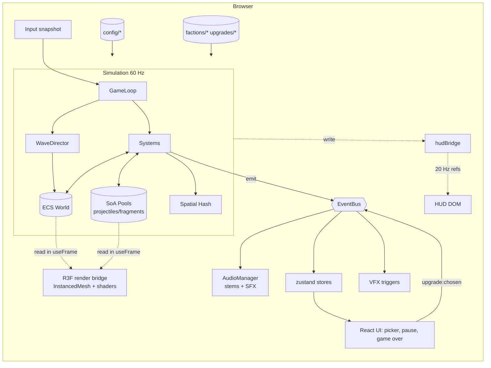

# Architecture

> This is the target design. Phase 1 implements the skeleton. Update this doc whenever the code diverges from it.

## 1. Principles
1. **The simulation is plain TypeScript and owns the truth.** React and three.js only *display* it.
2. **Fixed timestep.** The simulation runs at `TICK_RATE` (60 Hz). Rendering interpolates between ticks.
3. **Data-oriented hot paths.** Bullets, fragments and particles live in struct-of-arrays (SoA) typed-array pools. Less numerous things (player, enemies, props, pickups) live in a minimal ECS.
4. **Zero allocation per tick or frame.** Preallocate pools, reuse scratch vectors and event payload objects.
5. **Decoupled systems.** Systems read and write components and communicate through the EventBus.

## 2. Runtime layers
| Layer | Lives in | Frequency | Owns |
|---|---|---|---|
| Simulation | `game/core`, `game/ecs`, `game/systems`, `game/waves`, `game/entities` | 60 Hz fixed | Positions, HP, projectiles, spawning, collisions, XP |
| Render bridge | `game/rendering` (R3F components using `useFrame`) | display rate | Copies sim state into InstancedMesh matrices and uniforms, with interpolation |
| Audio | `game/audio` | event-driven + 10 Hz intensity update | Voices, music stems, mix |
| HUD bridge | `game/core/hudBridge.ts` + `ui/` | ~20 Hz throttled | Writes HP/energy/XP straight to DOM refs |
| UI state | `store/` (zustand) | on change only | Game phase, level-up choices, settings |

## 3. Game loop (`game/core/GameLoop.ts`)
```ts
// driven by R3F's useFrame (priority -100) so there is a single rAF
accumulator += min(frameDt, MAX_FRAME_DT)       // clamp spiral of death (0.25 s)
while (accumulator >= STEP && substeps < MAX_SUBSTEPS) {
  if (!paused) runSystems(STEP)                 // ordered phases, below
  accumulator -= STEP; substeps++
}
alpha = accumulator / STEP                      // render interpolation factor
```
- **Pause** stops sim ticks while rendering and the UI continue. Pause reasons form a bitmask (`ui`, `levelUp`, `hidden`), and the sim resumes only when all are cleared. `GameCanvas` maps store phase changes to `ui` and `visibilitychange` to `hidden`. The accumulator resets on resume, so there is no catch-up burst.
- **Run lifecycle:** `core/runtime.ts` holds the single live run (`runtime.ctx`, `runtime.loop`). `startRun(seed?)` and `endRun()` are called from `GameCanvas`'s mount effect. Render components read `runtime.ctx` inside `useFrame`. A `?seed=N` URL param pins the seed.
- `Time` exposes `tick`, `simTime`, `alpha`, `timeScale` (time dilation buff and hit-stop).
- `Rng` is a seeded PRNG (mulberry32) per run, for reproducible bugs. Never call `Math.random()` in the sim.

### System phases (in order)
1. `input` — sample the input snapshot (keyboard/mouse, cursor ground ray)
2. `director` — WaveDirector budget and spawns
3. `ai` — enemy movement and pattern emitter timers
4. `player` — movement, aura pulse, beam channel
5. `projectiles` — integrate the SoA pool, lifetime
6. `collision` — rebuild the spatial hash, run queries, queue hits
7. `damage` — apply hits, erasure accumulation, deaths → events
8. `destruction` — props → fragments
9. `progression` — XP pickup, level-up trigger
10. `cleanup` — despawn and return to pools, flush deferred events

## 4. ECS (`game/ecs/`)
Minimal and allocation-free:
- An `Entity` is a number: index (low 20 bits) plus generation (11 bits), to catch stale handles (`world.isAlive(e)`).
- Components are declared with `defineComponent<T>(name, create, reset)` in `ecs/components/`. A `ComponentStore<T>` is a sparse set whose dense `entities` and `data` arrays are packed. Swap-remove parks the removed data object past `size`, where the next `add` reuses it after `reset`, so steady-state spawning does not allocate.
- `World` provides `create()`, `destroy(e)` (deferred until `flush()`, which the `cleanup` system runs), `add(e, Def, init?)` (returns the component; hot paths mutate it rather than pass `init`), `get`, `tryGet` (on the store), `has`, `remove`, and `store(Def)`.
- **Queries:** `const q = world.query(A, B)` is created **once** in `init`. Each tick: `const n = q.collect(); for (let i = 0; i < n; i++) { const e = q.results[i]; ... }`. It iterates the smallest store and writes into a preallocated `Int32Array`, with no allocation.
- `System` interface:
```ts
export interface System {
  readonly name: string;
  readonly phase: SystemPhase;
  init?(ctx: GameContext): void;
  update(ctx: GameContext, dt: number): void;
  dispose?(ctx: GameContext): void;
}
```
- Systems are registered in order in `game/systems/index.ts`. `GameContext = { config, world, bus, time, rng, view, hud, debug, input, hits, player, cycle }`. Phase 3 adds `projectiles` and `grid`.
- **Input:** DOM listeners (`rendering/InputBinder.tsx`) write `rawInput` through the `config/input.ts` action map. The same component projects the cursor onto the ground plane each frame (useFrame −200, before the sim). The `input` system copies `rawInput` into `ctx.input` once per tick.
- **Damage pipeline:** producers (aura, beam, later bullets) push into `ctx.hits` (`HitBuffer`, preallocated SoA). The `damage` system drains it. A kill by the **beam** adds `Erasing` (dissolve, then `erasure` destroys it). A kill by anything else emits `enemy:killed` and destroys immediately.
- **Render reads:** player components call `readPlayerView(runtime.ctx)` (interpolated pose plus the `Player` component) once per useFrame.

**Projectiles are not ECS entities.** `entities/projectiles/ProjectilePool.ts` is SoA (`Float32Array` for x, z, vx, vz, radius, damage, life, age, param0..3 and `Uint8Array` for kind and flags) with a free list. Capacity comes from `config/performance.ts` (default 4096). Fragments and particles follow the same pattern.

## 5. Collision (`systems/collision`)
- Uniform **spatial hash grid** on XZ. Cell size is around 2× the typical enemy radius (configurable). The grid is cleared and rebuilt each tick from flat `Int32Array` buckets: a head and next linked list, no Maps.
- Shapes: circles (bullets, enemies, player, props) and **capsules/rays** (beam, lasers), with a segment–circle test that walks the grid cells along the segment (DDA).
- Hits are written to a preallocated hit buffer, which `damage` consumes.

## 6. EventBus (`game/core/EventBus.ts`)
Typed and synchronous, with listeners kept in arrays per type. Payload objects for high-frequency events are **reused**: listeners must copy, never store, a payload. UI-facing events are coalesced and forwarded to zustand or the HUD bridge.

| Event | Payload | Emitted by | Typical listeners |
|---|---|---|---|
| `run:start` / `run:end` | seed / stats | GameLoop | audio, store, director |
| `tick:paused` / `tick:resumed` | reason | GameLoop | audio, UI |
| `player:damaged` | amount, hpRatio | damage | VFX (distortion), audio, HUD |
| `player:lowHp` / `player:recovered` | hpRatio | damage | music, postFX |
| `player:died` | stats | damage | store (gameover), audio |
| `beam:start` / `beam:stop` / `beam:empty` | – | beam | audio, VFX |
| `aura:pulse` | radius, level | aura | audio, VFX |
| `enemy:spawned` | entity, archetypeId | director | audio intensity |
| `enemy:damaged` | entity, amount | damage | VFX hit flash |
| `enemy:erased` | entity, archetypeId, x, z, xp | damage | dissolve VFX, audio, XP drop |
| `enemy:killed` | entity, … | damage (aura kills) | explosion VFX, XP |
| `prop:destroyed` | propId, size, x, z | destruction | fragments, audio, XP |
| `projectile:fired` | factionId, kind, x, z | emitters (throttled) | audio |
| `xp:gained` | amount | progression | HUD |
| `player:levelUp` | level, choices[3] | progression | store (opens picker), audio stinger |
| `upgrade:chosen` | upgradeId | UI → store | upgrade system |
| `tier:changed` | tierId, cycle | director | music, UI banner |
| `boss:spawned` / `boss:defeated` | bossId | director/damage | music, UI |
| `cycle:started` | cycle | director | UI, music, postFX |
| `telegraph:spawn` | kind, x, z, duration | emitters | VFX, audio |
| `cutscene:done` | id, skipped | cutscene player | run start |

The authoritative list is `game/core/events.ts`. Keep this table in sync with it.

## 7. State ownership
| State | Owner | Why |
|---|---|---|
| Entity positions, HP, bullets, timers | Simulation (ECS + pools) | 60 Hz, never in React |
| Player HP/energy/XP for the HUD | `hudBridge` mutable object, written by sim, read by HUD at ~20 Hz via refs | No re-renders |
| Game phase (`menu`, `cutscene`, `playing`, `paused`, `levelUp`, `gameOver`) | `useGameStore` | Drives which UI is mounted |
| Level-up choices, chosen buffs list | `useGameStore` (set on event) | Low frequency |
| Settings (volumes, quality, debug) | `useSettingsStore` + `persist` (try/catch storage) | Persisted |
| Debug stats (FPS, entities, draw calls) | `debugBridge` mutable object, read by the F3 overlay at 4 Hz | No re-renders |

Rule: components may call `useGameStore(selector)` only for the low-frequency fields above. The sim reads the store imperatively (`useGameStore.getState()`), never through hooks.

## 8. Rendering strategy
- **One `InstancedMesh` per visual kind** (bullet type, enemy archetype mesh, fragment, XP orb), with capacity equal to its pool size. Each frame: write matrices for active slots, set `mesh.count`, and flag `instanceMatrix.needsUpdate` (and `instanceColor` when used). Bounding spheres stay unset or large: `frustumCulled = false` on pools.
- Bullets use a camera-facing quad or low-poly sphere with an emissive HDR core, so bloom catches them.
- Enemies with unique animation (bosses) are ordinary meshes, few in number.
- Postprocessing (`@react-three/postprocessing`): Bloom (mipmap, luminance threshold), ChromaticAberration (driven by hits), Vignette, Noise/Glitch (low HP), ToneMapping (ACES). Quality presets live in `config/rendering.ts`.
- Dissolve, aura and beam are custom `ShaderMaterial`s (see [ART_DIRECTION.md](ART_DIRECTION.md) and the `shader-vfx` skill).
- `frameloop="always"`, `flat` (the renderer does no tone mapping; the `ToneMapping` effect does), `dpr={[1, quality.maxDpr]}`, `gl={{ antialias: false, powerPreference: 'high-performance', stencil: false }}`. AA comes from postprocessing (SMAA) when quality allows.
- **useFrame priorities:** `-1000` DebugProbe resets `gl.info` → `-100` LoopDriver ticks the sim → `0` render pools copy state → `1` EffectComposer renders (any positive priority disables R3F auto-render, which the composer owns) → `10` DebugProbe reads draw calls for the whole multi-pass frame (`gl.info.autoReset = false` is set in `onCreated`).
- GLSL lives in TypeScript modules as template strings (`/* glsl */` tag). No raw-file loader is needed under Turbopack.

## 9. Data flow


## 10. Routing and boot
- `/` is the menu (React only, no canvas). It includes a "Play" button, settings, and the option to replay the intro.
- `/play` is a server page rendering `PlayClient` (a Client Component), which does `dynamic(() => import('@/game/GameCanvas'), { ssr: false })`. In Next 16, `ssr: false` is only allowed in Client Components. Flow: cutscene (first run, or when chosen) → `run:start`.
- `cacheComponents` is **off** (ADR-015). With it on, Next keeps left routes alive inside `<Activity>`, which would keep the WebGL route mounted.
- Next 16 has breaking changes from older versions. Before using a Next API, read `node_modules/next/dist/docs/` (see `AGENTS.md`).
- Audio unlocks on the first user gesture (the menu click), because browsers require one before the AudioContext can start.

## 11. Testing
- Vitest unit tests for pure modules: EventBus, ECS, spatial hash, pattern math, stacking rules, director budget, Cycle formulas.
- Soak test (later): a headless sim for N minutes that asserts constant pool and listener counts.
- Visual and E2E checks: the `webapp-testing` skill (Playwright screenshots and console errors).
